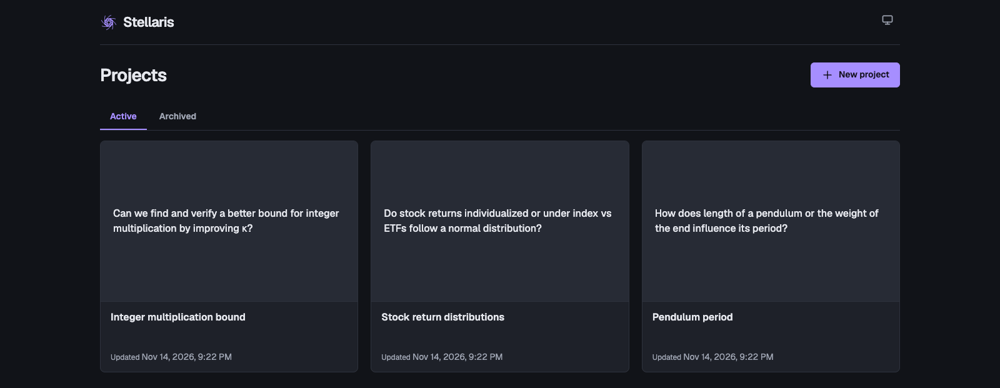
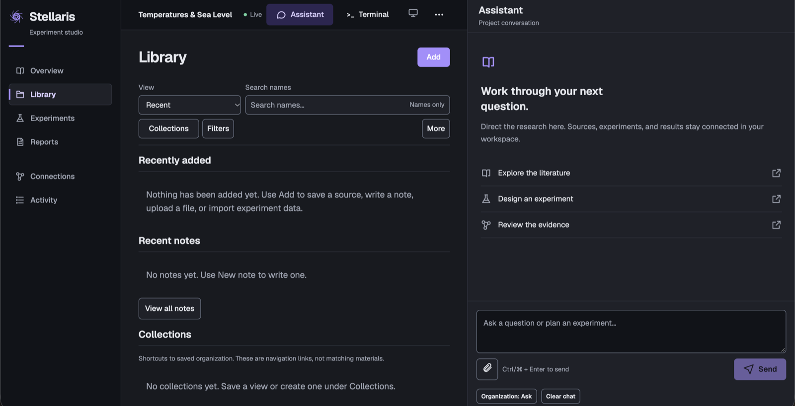
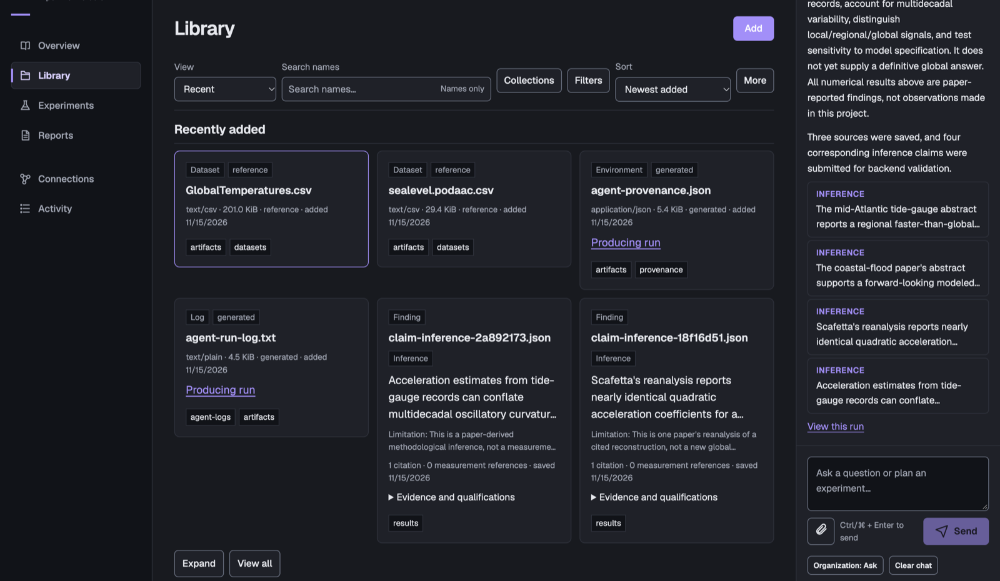
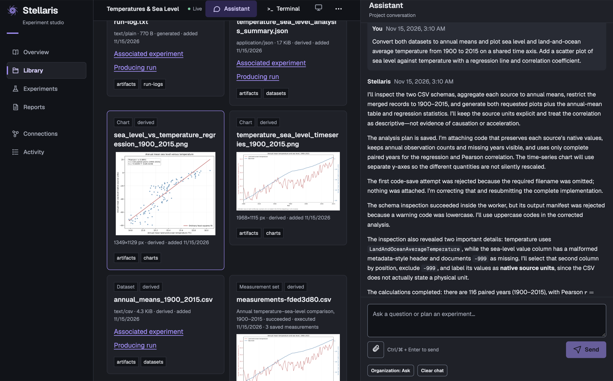
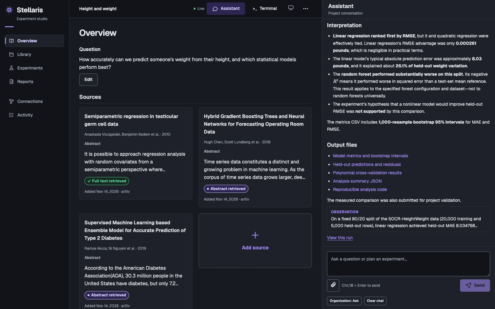
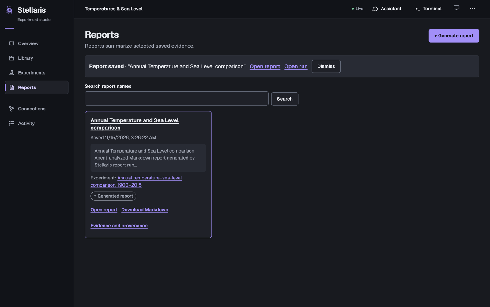
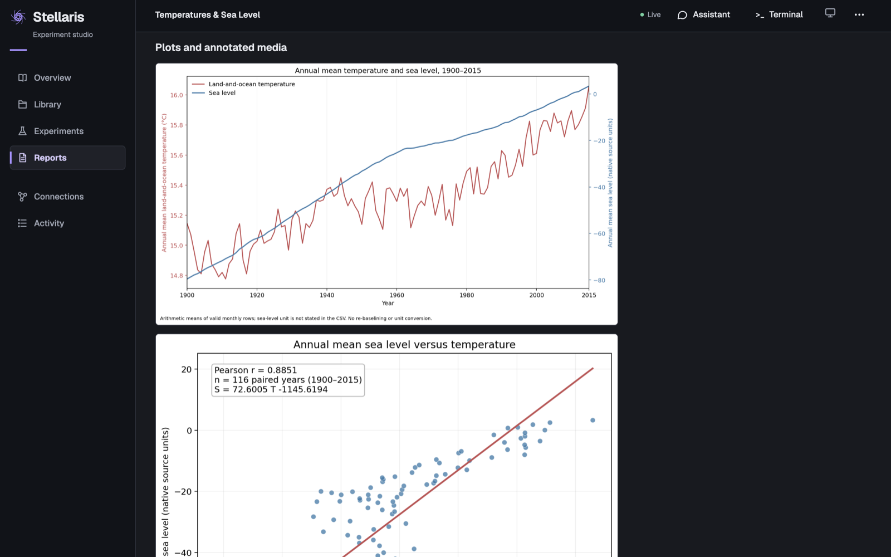

# Stellaris


https://github.com/user-attachments/assets/0abbd871-6744-475d-8aa9-5df8c1f53e66


[▶ Watch on YouTube](https://www.youtube.com/watch?v=FbN8rAKbveQ)


A persistent research workspace: ask a question, gather literature, run real experiments on your data in isolated workers, and turn the saved evidence into a scientific report. Every source, dataset, run, measurement and chart stays connected in one project.

Stellaris works across subjects and levels of difficulty. These projects each start from one research question:



- **Mathematics, advanced:** Can we find and verify a better bound for integer multiplication by improving κ? (builds on the OpenAI and CrocSwap repositories)
- **Finance, intermediate:** Do stock returns individualized or under index vs ETFs follow a normal distribution?
- **Physics, introductory:** How does length of a pendulum or the weight of the end influence its period?

## Run with Docker Compose

Start Docker Desktop, then run from the repository root:

```sh
docker compose -f backend/compose.yaml --profile build-only build
docker compose -f backend/compose.yaml up -d --wait
```

Open [Stellaris](http://localhost:3000). The API is available locally on port 8000. Live research, experiment design and report analysis need a model provider: copy the variable names from `backend/.env.example` into `backend/.env` and fill them in (never commit that file). See the [Compose guide](docs/docker-compose.md) for ports, logs, the hot-reload development override, and troubleshooting.

Stellaris has no authentication yet. Both ports bind to localhost only; do not expose them on a network.

## Tutorial: has sea-level rise tracked global warming?

This walkthrough uses two public monthly time series:
- `GlobalTemperatures.csv`, Berkeley Earth's global land and land-and-ocean temperatures with uncertainties ([Berkeley Earth data](https://berkeleyearth.org/data/)). Land-and-ocean values start in 1850 and the file ends in 2015.
- `sealevel.podaac.csv`, global mean sea level for 1900–2018 from the [NOAA PSL monthly time series](https://psl.noaa.gov/data/timeseries/month/). Its first line is a description rather than column names, each year's value is repeated for all twelve months, `-999` marks missing values, and the file does not state a unit.

The screenshots come from a real run. Your wording, sources and numbers will differ because the assistant searches and analyzes live.

### 1. Create a project with your question

On **Projects**, choose **New project**. Name it and enter the research question:

> How closely has global sea-level rise tracked global warming since 1900, and has the rate of rise accelerated?


### 2. Upload the datasets

Open **Library** and choose **Add**. Open **Assistant** at the top right; you can drag its left edge to make it wider.



Upload `GlobalTemperatures.csv` and `sealevel.podaac.csv`. They appear in Library as reference datasets, alongside the run logs and findings that later steps add.



### 3. Research

> Find relevant public arXiv literature for this project's research question and explain what the retrieved abstracts support. Make sure you fully review at least one of them.

The assistant searches arXiv and saves only the relevant results to **Overview**. Each source is marked by whether the assistant read its abstract or its full text. In this run it read Scafetta (2013) on errors in analyzing sea-level acceleration in full. It separates what the papers report from its own recommendations.


### 4. Hypothesis

Attach both datasets with the paperclip (**Attach project files**), then ask:

> Formulate a testable hypothesis about the relationship between global temperature and sea level using these two datasets.

The assistant framed the hypothesis around the rate of sea-level rise rather than its level, because two series that both rise over time can correlate strongly without one driving the other.


### 5. Visualization

> Convert both datasets to annual means and plot sea level and land-and-ocean average temperature from 1900 to 2015 on a shared time axis. Add a scatter plot of sea level against temperature with a regression line and correlation coefficient.

The assistant saves an experiment plan, writes Python, runs it in a temporary isolated worker, and saves the charts, the annual table and the measurements as evidence. In this run the correlation over 116 paired years was Pearson r ≈ 0.89. It inspected the files first, so it handled the sea-level file's header and `-999` values and labelled sea level in the file's own units.



### 6. Experiment

> Fit three models of sea level for 1900–2015: a linear time trend, a quadratic time trend (acceleration), and a semi-empirical model where the rate of sea-level rise is proportional to the temperature anomaly. Train on 1900–1995 and compare predictions on the held-out years 1996–2015.

The plan, protocol and attached script are saved under **Experiments**, where you can edit them or ask the agent to revise the script.



### 7. Analysis

> Compare the models' held-out RMSE and R². Is the acceleration term statistically significant, and does temperature explain sea-level rise better than time alone? Check whether the correlation survives detrending.

In this run the quadratic trend predicted the held-out years best (RMSE ≈ 5.9, against ≈ 7.1 for the linear trend). The semi-empirical model as fitted did much worse (≈ 34.6). Values are in the sea-level file's own units. For the rest of the question, the assistant planned a follow-up run that tests the acceleration term with autocorrelation-robust (Newey–West) errors and checks the correlation after detrending.


### 8. Report

> Generate a scientific report with the hypothesis, methodology, visualizations, experimental results, limitations, and citations.

Reports are generated from saved evidence rather than written freehand in chat. Open **Reports**, choose **Generate report**, pick the experiment and the analysis runs and literature sources to include, and select **Generate Markdown report**. A dedicated report agent analyzes the selected evidence and saves a Markdown report that can't be edited afterwards. You can read and download it.



The report includes the charts from the analysis runs:



### 9. See how everything connects

**Connections** draws every saved file and its recorded provenance: datasets, each analysis run, the charts and CSVs it produced, findings, and the sources they cite. Linked files cluster together, larger dots have more links, and hovering a file highlights its neighborhood with link directions. This illustrative example uses sample data with several analysis runs:


## Documentation

All authored documentation lives in [`docs/`](docs/README.md). Start with the [Compose guide](docs/docker-compose.md). The frontend also serves this documentation tree at `/docs/`. Product scope is in the [product vision](docs/product-vision.md), the API in the [frontend-backend contract](docs/frontend-backend-contract.md), and design direction in [`docs/design/`](docs/design/).
