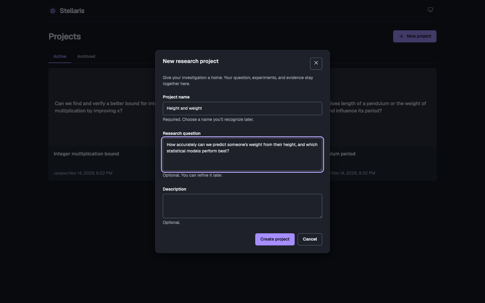
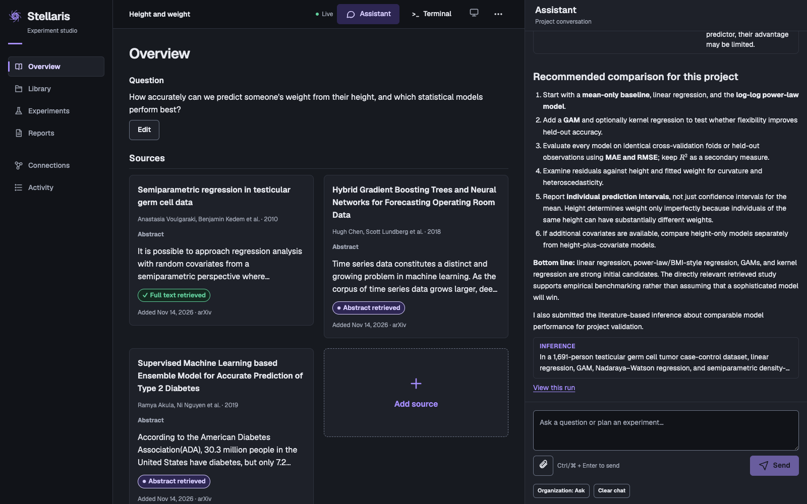
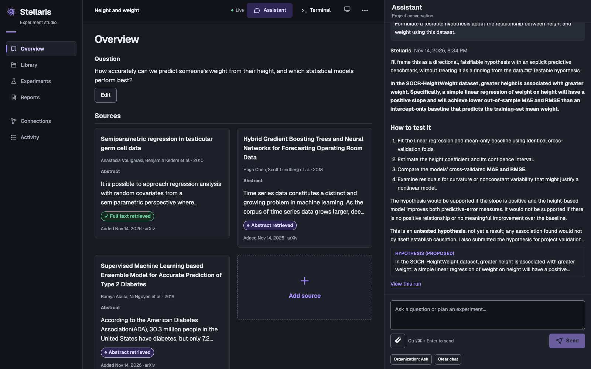
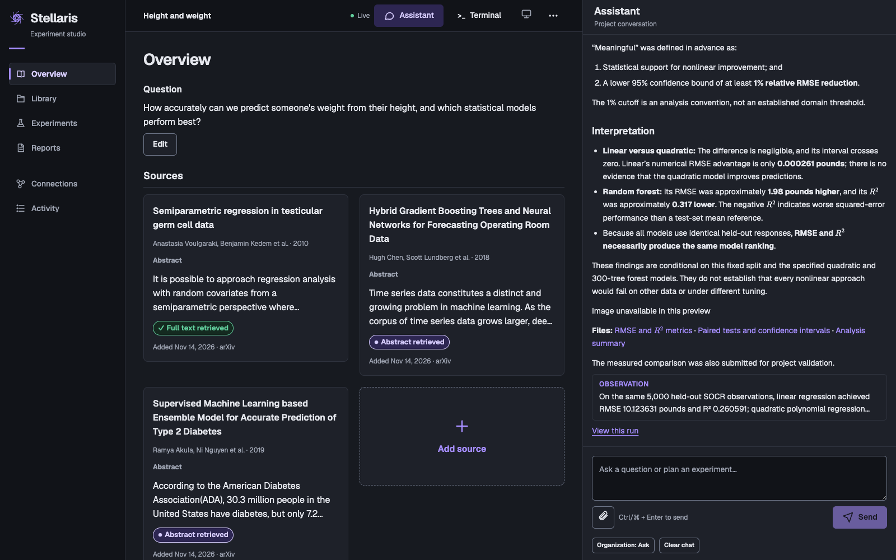
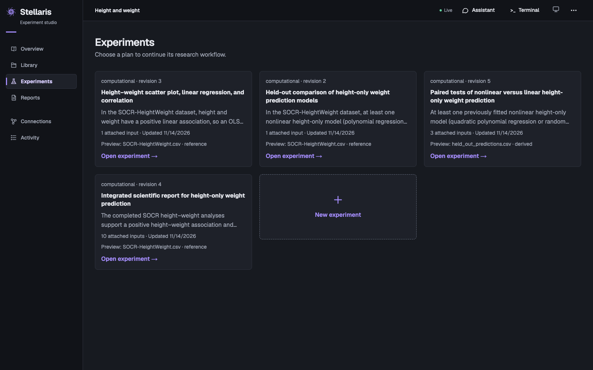
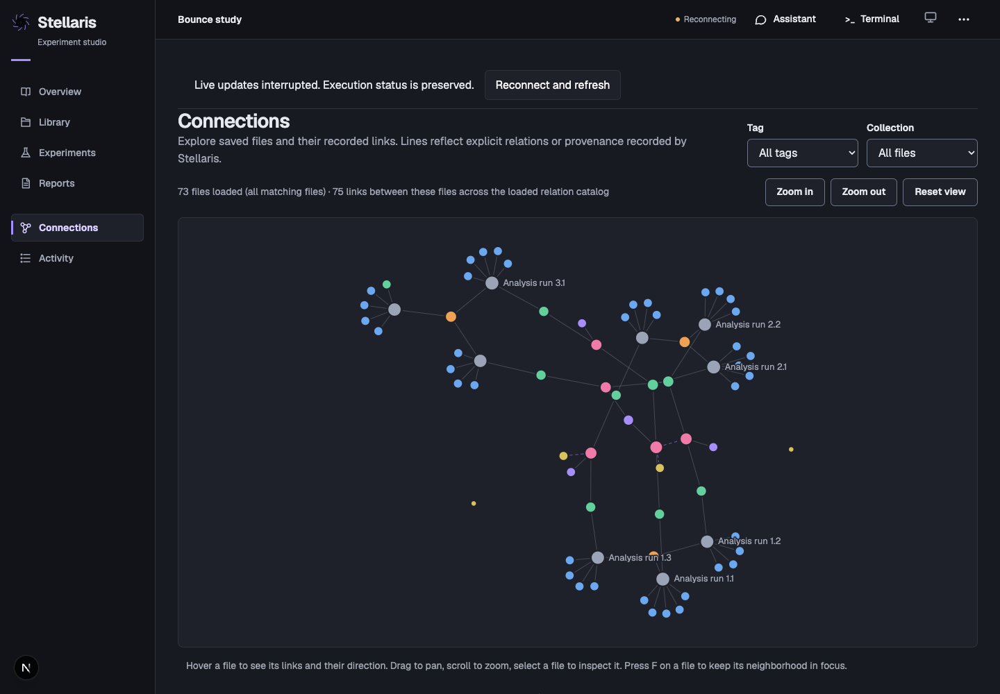

# Stellaris

A persistent research workspace: ask a question, gather literature, run real experiments on your data in isolated workers, and turn the saved evidence into a scientific report. Every source, dataset, run, measurement and chart stays connected in one project.

Stellaris works across subjects and levels of difficulty. These projects each start from one research question:


- **Mathematics, advanced:** Can we find and verify a better bound for integer multiplication by improving κ? (builds on the OpenAI and CrocSwap repositories)
- **Finance, intermediate:** Do stock returns individualized or under index vs ETFs follow a normal distribution?
- **Physics, introductory:** How does length of a pendulum or the weight of the end influence its period?

## Run with Docker Compose

Start Docker Desktop, then run from the repository root:

```sh
docker compose -f backend/compose.yaml --profile build-only build
docker compose -f backend/compose.yaml up -d --wait
```

Open [Stellaris](http://localhost:3000). The API is available locally on port 8000. Live research, experiment design and report analysis need a model provider: copy the variable names from `backend/.env.example` into `backend/.env` and fill them in (never commit that file). See the [Compose guide](docs/docker-compose.md) for ports, logs, the hot-reload development override, and troubleshooting.

Stellaris has no authentication yet. Both ports bind to localhost only; do not expose them on a network.

## Tutorial: how well does height predict weight?

This walkthrough uses the public [SOCR height and weight dataset](http://wiki.stat.ucla.edu/socr/index.php/SOCR_Data_Dinov_020108_HeightsWeights) (25,000 records of height in inches and weight in pounds) saved as `SOCR-HeightWeight.csv` with the columns `Index,Height(Inches),Weight(Pounds)`. The screenshots come from a real run; your wording, sources and numbers will differ because the assistant searches and analyzes live.

### 1. Create a project with your question

On **Projects**, choose **New project**. Name it and enter the research question:

> How accurately can we predict someone's weight from their height, and which statistical models perform best?



### 2. Upload the dataset

Open **Library**, choose **Add**, and upload `SOCR-HeightWeight.csv`. Open **Assistant** at the top right; you can drag its left edge to make it wider.


### 3. Research

> Find scientific literature on the relationship between height and weight. What statistical models are commonly used?

The assistant searches arXiv, saves the sources it actually retrieved to **Overview**, marks whether it read the abstract or the full text, and separates what the papers report from its own recommendations.



### 4. Hypothesis

Attach the dataset with the paperclip (**Attach project files**), then ask:

> Formulate a testable hypothesis about the relationship between height and weight using this dataset.



### 5. Visualization

> Generate a scatter plot of height vs. weight, with a regression line and correlation coefficient.

The assistant saves an experiment plan, writes Python, runs it in a temporary isolated worker, and records the measurements (here Pearson r ≈ 0.50 and R² ≈ 0.25 over all 25,000 rows) with the chart and summary CSV as evidence.


### 6. Experiment

> Train linear regression, polynomial regression, and random forest models to predict weight from height. Compare their performance on held-out data.


### 7. Analysis

> Compare model RMSE and R². Test whether nonlinear models meaningfully outperform linear regression.

In this run linear regression held up best (held-out RMSE ≈ 10.1 lb, R² ≈ 0.26); quadratic regression was effectively tied and the random forest did worse, so the nonlinear models did not meaningfully outperform the linear one.



Each step that ran code is saved as its own experiment, with inputs, code, outputs and measurements, under **Experiments**:



### 8. Report

> Generate a scientific report with the hypothesis, methodology, visualizations, experimental results, limitations, and citations.

Reports are generated from saved evidence rather than written freehand in chat. Open **Reports**, choose **Generate report**, pick the experiment and the analysis runs and literature sources to include, and select **Generate Markdown report**. A dedicated report agent analyzes the selected evidence and saves an immutable Markdown report you can read and download.

### 9. See how everything connects

**Connections** draws every saved file and its recorded provenance: datasets, each analysis run, the charts and CSVs it produced, findings, and the sources they cite. Linked files cluster together, larger dots have more links, and hovering a file highlights its neighborhood with link directions. This example comes from a bouncing-ball study with several analysis runs:



## Documentation

All authored documentation lives in [`docs/`](docs/README.md). Start with the [Compose guide](docs/docker-compose.md). The frontend also serves this documentation tree at `/docs/`. Product scope is in the [product vision](docs/product-vision.md), the API in the [frontend-backend contract](docs/frontend-backend-contract.md), and design direction in [`docs/design/`](docs/design/).
