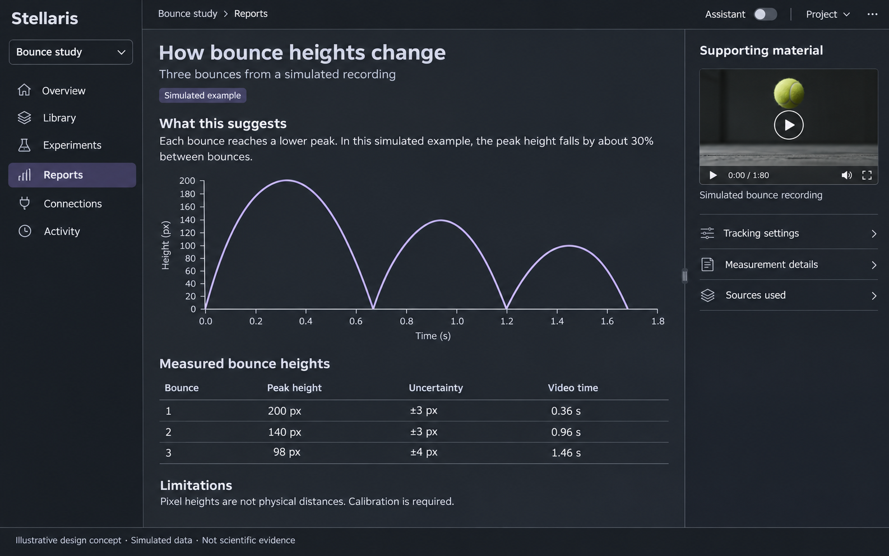

# Continuous studio: light and dark direction

Draft recorded November 14, 2026. The user selected the continuous dark studio image as the preferred compositional reference, with modestly adjusted contrast for the main document and a toggleable light mode.

**Priority confirmed during PR #11 integration, November 14, 2026:** This direction
and the preferred visual reference below are the core of the next frontend theme
work. They take priority over earlier layout and fixed palette prescriptions.
The merge preserves the existing experiment studio interface while integrating
agent-led report analysis. The continuous light/dark redesign remains upcoming,
and its unresolved controls and sizing decisions are still described below.

This document distinguishes confirmed preferences, design work still needed, and details invented by image generation. It does not authorize implementation or claim that the application already supports these themes. The earlier [experiment studio specification](experiment-studio.md) records the implemented interface. The [human experience issue log](human-experience-issues.md) records unresolved reading, language, and interaction problems.

## Confirmed direction

- Build light and dark modes around the same continuous studio composition.
- Use the selected image as a reference for hierarchy, subdued surrounding tools, and integrated reading and analysis content.
- Adjust the main document's contrast modestly so it separates more clearly from the surrounding workspace. The exact luminance difference remains to be explored.
- Keep Assistant, Terminal, and project actions together toward the right of the top utility bar.
- Treat this as a redesign of surfaces, content hierarchy, typography, and working space. A palette swap on the current Markdown presentation is insufficient.

The desired experience is focused and suitable for sustained work. Consistency must extend to dense reports, interactive graphs, input fields, and open panels, rather than only one attractive report screen.

## Preferred visual reference

The image is a generated visual reference, not a screenshot of working Stellaris features. Its data and recording are illustrative. Its labels, controls, timing, and geometry do not establish scientific or interface behavior.

What to carry forward:

- A continuous dark working field, with subtle boundaries between navigation, content, and supporting material.
- A report whose interpretation, figure, measurements, and limitations belong to one reading composition.
- Surrounding controls that carry less emphasis than the actual work.
- Readable table columns and human-facing content names, rather than raw field names and artifact identifiers.
- A compact supporting panel that does not visually compete with the main content.

These are compositional qualities, not approval of every pixel, label, or dimension.

## Surface hierarchy in both modes

The main work should be distinguishable from application framing without becoming an isolated bright card surrounded by unrelated panels. Evaluate a small increase in the main document's luminance relative to the dark surround, together with text contrast and boundaries. The requested adjustment is modest. A white paper sheet is not the selected direction.

Light mode needs its own considered surface relationships. Explore a subdued cool surround and a clearer reading or working surface, while avoiding broad undifferentiated white areas. Retain the same navigation, hierarchy, panel roles, and content order in both modes. Light mode must remain a fully usable alternative.

Resolve these roles before choosing exact colors:

- Surrounding workspace and empty space.
- Sidebar and utility header.
- Primary reading or experiment surface.
- Assistant and item inspector.
- Inputs, menus, dialogs, and other interactive surfaces.
- Hover, selection, focus, disabled, loading, warning, and failure states.

The violet in the image is a reference accent, not a newly fixed palette requirement. Final color values, typography tuning, spacing, borders, and density remain draft decisions. The generated image's soft shading is not a requirement for gradients, texture, or metallic effects.

A mode switch should preserve work and should not change what the data means. Do not invert scientific images, video, figures, or plots blindly. Charts and terminal output need deliberate legible treatments appropriate to each mode.

A visible light/dark choice is confirmed. Its placement, initial mode, persistence, system-preference behavior, and any separate System option are not yet decided. The reference contains no reliable design for this control.

## Top bar and navigation authority

Assistant, Terminal, and project actions belong toward the right of one top utility bar. Project identity and navigation context can remain to its left. The missing Terminal in the image is an omission, not permission to remove or relocate it.

The current [ProjectHeader](../../frontend/components/shell/ProjectHeader.tsx) has real Assistant and Terminal visibility controls, connection status, and project actions. Preserve the meaning of those behaviors when designing their new appearance.

The pictured Assistant on/off switch is a placeholder invented for the image. It must not be interpreted as enabling the model provider, activating an agent, granting permissions, or sending a message. Opening a panel and initiating agent work are different operations. A final control needs a clear purpose, label, state, focus treatment, and keyboard behavior.

The image also repeats project context through a sidebar chooser, breadcrumb, and a Project dropdown. That repetition is not an approved project-navigation design. The dropdown's contents and behavior are not defined by the picture. Retain the user's top-right placement requirement while resolving these controls from real product behavior.

Sidebar widths and resize handles in the image are illustrative. The request for adjustable panels remains open in HX-05. No exact width, minimum, persistence rule, or mobile behavior has been selected.

## Assistant and chat input: exploration still required

The reference shows no actual Assistant conversation or composer. It provides no evidence that the theme works for chat inputs. The small switch cannot stand in for that missing design work.

The existing [chat composer](../../frontend/features/research/chat/ChatComposer.tsx) includes multiline text, attachments, Send, keyboard guidance, disabled states, and retry/error behavior. The [conversation surface](../../frontend/features/research/chat/ResearchChat.tsx) supplies the real project conversation. These behaviors are the starting point, not controls to replace with invented image details.

Further references need to show, in both modes:

- An open Assistant panel beside meaningful main content.
- The composer at rest, focused, with multiline text, and with attachments.
- Clear boundaries between editable input, messages, quotes, code, and cited sources.
- Sending and streaming states, errors and retry, unavailable capabilities, and archived-project restrictions.
- A legible distinction between user messages, assistant interpretation, and saved scientific evidence.
- A narrow panel, a resized panel, and a mobile sheet.

No bubble style, composer enclosure, placeholder treatment, or input palette is approved yet. Preserve draft and attachment state through resizing, mode changes, and panel collapse. The exact visual design remains to be explored.

## Other details the image does not settle

**Terminal:** Its absence is generated-image incompleteness. Design the real terminal panel, its header, input, selection, scrollback, error colors, and resize boundary in both modes. Keep its top-right access point.

**Supporting material:** This is a useful human-facing role for a panel, not approval of the exact sections shown. Tracking settings, Measurement details, and Sources used must map to real available content. Do not manufacture sources or settings to match the reference.

**Report content:** The example interpretation, values, uncertainty, trajectory curves, and times were created to illustrate a reading layout. They are not a validated experiment, a report template, or a specification of what analysis can establish. Preserve the distinction between simulated and observed data and between pixel and physical units.

**Video controls:** The malformed timecode and other playback details are image-generation artifacts. They do not define a media player or time format.

**Footer:** The concept disclosure identifies this generated example. It is not a proposed permanent footer on every production screen. Real simulated data must still be identified where it is presented.

**Icons and text:** The pictured icons, exact font weights, control sizes, and line spacing are provisional. Do not trace the bitmap or reproduce its inconsistencies as a design system.

## Remaining scope and decision state

This reference addresses the overall composition. Agent-led report interpretation is now implemented under the [report specification](../reports-spec.md#required-agent-led-analysis). Its narrative and original evidence should share this reading composition. The full measurement presentation, source-reference language, graph crowding and hover labels, Library filtering, and Overview's technical summaries remain open in the [issue log](human-experience-issues.md).

Future exploration should demonstrate this direction across Overview, Experiments, Library, Reports, and Connections, with real content density and open supporting tools. Check the main document's contrast and Assistant inputs explicitly in both modes. Include long text, uncertainty explanations, wide tables, and crowded graphs rather than relying on the simplified example.

Confirmed: the continuous studio direction, light and dark modes, a modest document-contrast adjustment, and top-right access to Assistant, Terminal, and project actions. Everything listed as unresolved remains a design question. No application code changes are part of this documentation update.
