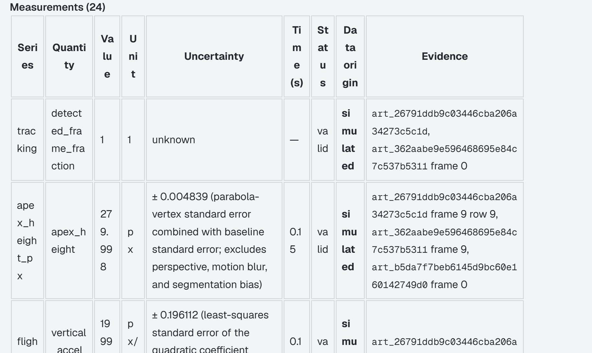
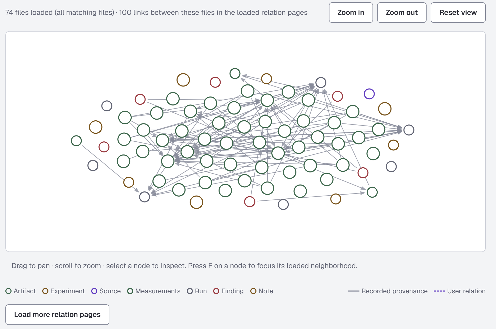

# Human experience and visual redesign: open issues

Recorded November 14, 2026 from user feedback and two supplied screenshots. This is a public-facing discussion log in the canonical documentation tree. It records problems and unresolved design questions. It does not authorize fixes or describe completed improvements. The later [continuous studio direction](continuous-studio-direction.md) records the subsequent theme preference.

The [experiment studio implementation](experiment-studio.md) made the interface more consistent. The user considers that consistency useful, but the human reading experience and visual identity still need substantial redesign. The existing palette is implemented, not a settled final direction.

## What should be preserved

The user considers Experiments good, Library broadly acceptable, and Overview solid in its overall structure. Connections is useful despite its presentation problems. Keep those positive assessments distinct from the issues below. They do not imply that every interaction or content presentation has been accepted.

## HX-01: Reports expose the system's vocabulary instead of explaining the experiment

**Status:** Open. Reported by the user and supported by screenshot 1.

The report reads close to the language used to store or process the data. Visible examples include `detected_frame_fraction`, `apex_height_px`, machine-like series names, and long `art_...` references. Readers have to decode the system before they can understand the result.

The user wants a human-focused view of interpretations, understandable names, and meaningful data. This is a distinction between the saved scientific record and the experience of reading it, not simply a request to remove underscores.

Subsequent PR #11 integration adds [agent-written report analysis](../reports-spec.md#required-agent-led-analysis)
alongside the saved evidence summary. This addresses narrative generation. Measurement
readability, human-facing labels, and the reading composition remain open design work
under the continuous studio direction.

Open questions:

- What should a reader understand about what happened, what was measured, and what it means?
- Which measurements help answer the experiment's question, and which describe the analysis process?
- Where do detailed records belong relative to the main explanation?
- How should interpretation stay visibly distinct from observation, inference, and simulation?

The screenshot explicitly marks its data as simulated. Pixel measurements must not become physical heights without calibration. A display change must preserve unknown uncertainty, limitations, and source traceability. No specific interpretation of these measurements has been validated in this review.

## HX-02: The measurement table is not readable

**Status:** Open. Directly visible in screenshot 1.

Headings such as Series, Quantity, Value, Unit, Time, Status, and Data origin break into multiple fragments. Numbers and units also wrap. Long uncertainty explanations and artifact references occupy much of the width, while short values receive very narrow columns. Rows become tall and difficult to compare.

This is a reading failure even if the table technically fits its container without horizontal overflow. Previous layout checks did not establish that scientific content was readable.

Open questions:

- What information needs to be compared together?
- Which fields deserve space in the primary reading view?
- How should long explanations and detailed references coexist with readable values?
- What constitutes a successful layout with realistic report content and available panel widths?

No table structure or responsive solution is selected here.

**Progress, November 14, 2026:** Report Markdown now renders through one sanitized renderer (`frontend/components/ui/MarkdownView.tsx`). Table headings no longer wrap, numbers align right, uncertainty explanations and missing-value reasons sit in a smaller line under their value, known stored names show reader-facing labels (`apex_height_px` → “Peak heights (px)”, with the original in a tooltip), and resource IDs become short linked chips. Wide tables scroll inside their own region. Downloads keep the original Markdown. Which columns belong in the primary reading view remains open.

## HX-03: “Evidence and provenance” is difficult to understand

**Status:** Open. Label difficulty reported by the user. Raw references are visible in screenshot 1.

The label assumes familiarity with a technical concept before explaining why the section matters. Raw artifact IDs add a second translation burden. A reference can be exact for software while conveying little to a person.

The unresolved issue is how to communicate what supports a result and where it came from in ordinary language, while retaining precise references. No replacement label is approved. The same concern applies to other internal terms where they appear in the reading experience.

## HX-04: Connections is useful but visually crowded

**Status:** Open. Density and node sizing are visible in screenshot 2. Hover-label obstruction is reported by the user and is not demonstrated by the still image.

The supplied graph reports 74 loaded files and 100 links. Large hollow circles occupy substantial space. Crossing links and repeated arrowheads compete with the nodes. The user reports that some labels disappear behind other elements when hovering.

An additional visible ambiguity is that Artifact and Measurements share a legend color, as do Experiment and Note. Color alone does not distinguish those categories in this capture.

The user suggested Obsidian's graph as a visual reference. Record that as a direction for investigation, not a decision to copy its behavior or change Stellaris's relationship model. Directed scientific lineage and user-created relationships still have distinct meanings.

Open questions concern node scale, link emphasis, label readability and layering, and what should remain visible while inspecting a neighborhood. No graph implementation or styling change is approved.

**Progress, November 14, 2026:** The earlier layout placed files on a spiral sorted by type and ignored relations, so links crossed the whole canvas. Connections now uses a deterministic force layout driven by recorded relations, small filled nodes sized by link count, one distinct color per role, and one line per connected pair. Hovering or focusing a file highlights its links with direction arrows and dims the rest; labels draw in a top layer so they are never hidden. Zoom follows the pointer. Directed provenance and dashed user relations stay distinct.

## HX-05: Fixed panel widths do not fit different tasks

**Status:** Open. Reported by the user.

The user wants adjustable sidebar and panel widths. Current fixed sizes can be acceptable for one task and severely constrain another. Reading a long interpretation, inspecting a graph item, and using Assistant have different space needs.

The exact panels covered, resize behavior, limits, persistence, keyboard access, and narrow-screen behavior remain undecided. This log records the need for adjustable space without prescribing a control or layout system.

## HX-06: Library filtering feels cluttered and unintuitive

**Status:** Open. Reported by the user. No Library screenshot was supplied in this feedback.

Library is broadly acceptable, but its filtering system still asks the user to interpret too many controls and their relationships. The previous consolidation into a toolbar has not resolved the experience.

Open questions concern how people distinguish a view, collection scope, search, filters, and ordering, and how they recognize what is currently narrowing their results. Do not assume that merely hiding more controls would resolve the confusion. No replacement interaction is selected.

## HX-07: Overview has a good structure but technical content

**Status:** Open. Reported by the user.

Overview's overall composition works. Its Experiments, Results, and Reports content can still feel like a view into code or internal records. This connects to HX-01: improving destination labels did not fully translate the content inside those destinations.

The open question is what each summary should communicate to someone continuing an investigation. Preserve the useful overall organization while assessing the language and information shown within it.

## HX-08: The visual theme does not create the intended focus

**Status:** Open. Reported by the user, with the light surfaces visible in both screenshots.

The user describes the result as a bland default Markdown theme. Consistent typography, controls, and accent colors have not produced the desired sense of being absorbed in the work. The surrounding space and content have too little perceptual separation, so the actual content does not command attention.

The user associates broad light empty areas with visual activity and an expectation that something belongs there. They want to investigate darker surrounding space and stronger separation of meaningful content. Record this as the user's perceptual experience and a design hypothesis to explore, not as a universal scientific claim about brightness or attention.

The request is for a true visual redesign. Changing a few contrast colors in the existing layout would not satisfy it. The unresolved work includes composition, surface hierarchy, content framing, density, typography, and the relationship between work area and application chrome.

At the initial review, no replacement theme was selected. The subsequent [continuous studio direction](continuous-studio-direction.md) selects the continuous composition with light and dark modes and a modest document-contrast adjustment. Exact colors, typography, and detailed layouts remain unresolved. Electric violet and the prior light palette should not be treated as requirements merely because they were chosen for the previous pass.

## HX-09: AI, technical, scientific, and human language need clear roles

**Status:** Open. Cross-cutting synthesis of the user's feedback.

The interface moves between AI-oriented conversation, internal execution records, scientific terminology, and the language someone needs to understand an experiment. Those forms currently leak into one another. Neither conversational fluency nor faithful rendering of a data structure guarantees a useful explanation.

This affects names, summaries, interpretations, measurements, references, and graph descriptions. A future direction needs to establish how each is expressed for the reader while preserving the scientific record. Human-facing language must remain accurate and must not replace unknowns with confident AI interpretations.

This log originally approved no interpretation pipeline. Agent-led report analysis
was subsequently implemented and accepted under the [report specification](../reports-spec.md#required-agent-led-analysis).
Its [recorded follow-ups](../verification/report-analysis.md#recorded-follow-ups) remain
visible while the frontend design work continues.

## Supplied visual evidence

Screenshot 1 shows the report measurement table, including simulated data labels, fragmented headings, wrapped values, long uncertainty text, and raw artifact IDs.

Screenshot 2 shows the Connections graph with 74 loaded files and 100 links. It supports the density and node-size observations, but cannot establish the reported hover-label behavior.

These files preserve the supplied screenshots unchanged. Screenshots establish visible presentation only, not the scientific validity of their contents.

## Decision state

The user requested logging and discussion rather than fixes. All issues remain open as implementation and usability work. The later reference selection narrows the theme exploration without resolving the other issues. This review changes documentation only. It does not change application code, perform a new browser audit, or publish content to an external service.
